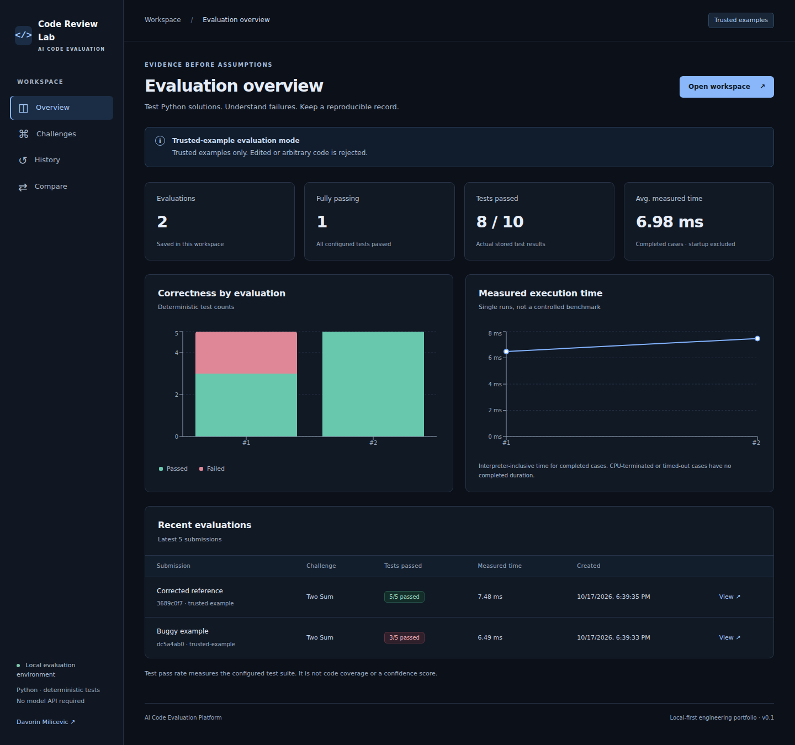
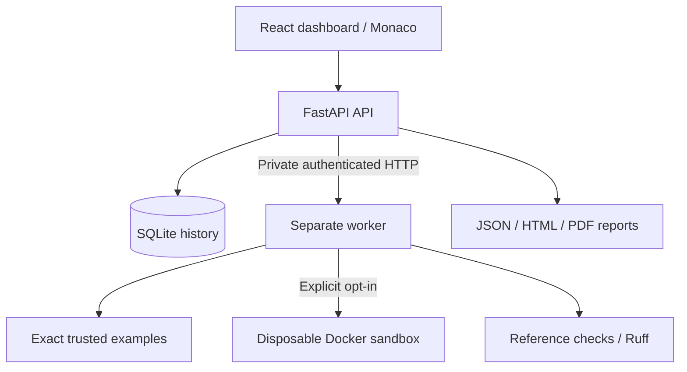

# AI Code Evaluation Platform

[](https://github.com/Davorin51/ai-code-evaluation-platform/actions/workflows/ci.yml)


[](LICENSE)

**Evidence-driven review of Python solutions, including AI-generated candidates.**

A local-first engineering portfolio: deterministic correctness tests, reproducible failure
examples, reference checks, Ruff findings and downloadable review reports. A React dashboard
shows results returned by a FastAPI backend and a separate execution worker.

**Safe default:** only exact, repository-owned examples execute in trusted mode. Editing or
submitting arbitrary code requires explicitly enabling the disposable Docker runner on a
dedicated Linux Docker environment. The API never executes candidate Python.



[Workspace and failure details](docs/screenshots/workspace.png) ·
[Side-by-side comparison](docs/screenshots/comparison.png) ·
[Mobile view](docs/screenshots/overview-375.png)

Screenshots come from the running application using the real API and separate worker.
Timings vary by run; charts contain measured results, not sample dashboard placeholders.

## What you can demonstrate

- Eight original exercises spanning algorithms, data structures and business data processing.
- A buggy Two Sum solution that passes 3/5 cases, then a corrected reference that passes 5/5.
- Per-test inputs, expected/actual values, error categories and reference comparison.
- Measured completed-case times and peak process RSS, accurately scoped.
- Monaco Python editor, live charts, submission history and side-by-side comparison.
- JSON, standalone HTML and PDF reports with source checksums and execution limits.
- SQLAlchemy 2.x persistence, Alembic migrations, structured JSON logs and bounded inputs.
- pytest/Hypothesis tests, Ruff, frontend build/E2E checks and real Docker isolation tests in CI.

This is a portfolio implementation, not a claim of public multi-tenant production readiness.
No paid API or model integration is required. “AI-generated” is a user-supplied source label;
the tool evaluates behavior, not whether code was written by AI.

## Architecture



The worker verifies the reference against each versioned expected output, executes the
candidate separately, compares JSON values with strict types and classifies failures.
Expected outputs stay outside the candidate process. Each test has a new interpreter or
container. No submitted code is imported into the API process. Ruff parses source without
executing it. See [architecture](docs/architecture.md) and [security](SECURITY.md).

## Quick start: Docker Compose

Requires Docker Engine with Compose on Linux or Docker Desktop.

```bash
git clone https://github.com/Davorin51/ai-code-evaluation-platform.git
cd ai-code-evaluation-platform
cp .env.example .env
docker compose up --build
```

Open **http://localhost:8080**. The default stack has no Docker socket mounted anywhere,
no publicly bound worker or API ports, and a localhost-only frontend port. SQLite history
persists in the `history` volume. Replace the development worker token in `.env` on shared
machines. Do not expose this stack directly to the internet.

## Local development

The execution worker requires Linux (WSL2 is suitable); its resource accounting uses Linux
`resource` limits and KiB RSS. Node 22+ and Python 3.11+ are supported.

```bash
python -m venv .venv
source .venv/bin/activate
pip install -r requirements.lock
pip install --no-deps -e .
cp .env.example .env
alembic upgrade head
```

Run these in three terminals, from the repository root with the virtual environment active:

```bash
# Terminal 1 - private worker; only exact trusted examples by default
uvicorn worker.main:app --host 127.0.0.1 --port 8001

# Terminal 2 - API
uvicorn backend.app.main:app --host 127.0.0.1 --port 8000

# Terminal 3 - dashboard, same-origin /api proxy
cd frontend
npm ci
npm run dev
```

Open http://localhost:5173. API documentation: http://localhost:8000/docs.
`requirements.lock` and `frontend/package-lock.json` capture tested dependency versions.
The Python lock includes development/test tools for a single reproducible environment.

## Evaluation walkthrough

1. Open **Challenges**, select **Two Sum**, keep **Buggy example**.
2. Click **Run Evaluation**. The actual bundled candidate passes **3/5** tests.
3. Expand **no-reuse**: input `[3]`, target `6`, expected `[]`, actual `[0, 0]`.
4. Select **Verified reference** and rerun: **5/5** configured tests pass.
5. Review Ruff findings separately; static analysis does not establish correctness.
6. Download JSON, HTML or PDF. Compare both saved submissions in **Compare**.

For a scripted demonstration with the two servers running:

```bash
python scripts/demo.py
```

Browse the actual exported results without installation:

| Candidate | JSON | HTML | PDF |
| --- | --- | --- | --- |
| Buggy example, 3/5 | [JSON](examples/reports/two-sum-buggy.json) | [HTML](examples/reports/two-sum-buggy.html) | [PDF](examples/reports/two-sum-buggy.pdf) |
| Corrected reference, 5/5 | [JSON](examples/reports/two-sum-reference.json) | [HTML](examples/reports/two-sum-reference.html) | [PDF](examples/reports/two-sum-reference.pdf) |

This saves real backend responses and reports under `examples/reports/`; it does not insert
fabricated history. Exported timings are environment-specific single measurements, not
comparative speed claims. The supplied examples are repository-owned test exercises, not
commercial evaluation-platform tasks or customer data.

## Enable arbitrary candidate evaluation (optional)

Read [SECURITY.md](SECURITY.md) first. Use a disposable/dedicated Linux Docker VM.
A worker with Docker socket access can control that daemon; isolate that VM from valuable
host resources. Docker is not a sufficient public multi-tenant security boundary.

```bash
docker build -f worker/Dockerfile.sandbox -t ace-sandbox:local .
export ACE_DOCKER_GID=$(stat -c '%g' /var/run/docker.sock)
docker compose -f compose.yaml -f compose.sandbox.yaml up --build
```

Only the **private worker** receives the daemon socket. The API/frontend do not.
The dashboard unlocks editing only when the worker reports Docker mode as available.
Each candidate container has no network, a non-root user, read-only root, dropped
capabilities, no-new-privileges, CPU/memory/PID/output limits and a bounded tmpfs.
The sandbox image is local and never pulled at evaluation time. Infrastructure errors
fail closed; there is no arbitrary-code host fallback. See [execution details](docs/architecture.md).

## Challenges

| Exercise | Contract detail |
| --- | --- |
| Two Sum | First discovered pair; distinct indices; preserve first duplicate index |
| Binary Search | Lowest matching index, including repeated values |
| Valid Parentheses | Matching types and nesting; non-brackets invalid |
| Merge Intervals | Closed, touching intervals merge; contained ranges never shrink |
| Find Duplicates | Unique repeated values, sorted |
| Reverse Linked List | Reverse actual next pointers in a JSON node table |
| Data Validation | Reject booleans as quantities; report invalid row indices |
| CSV Processing | Quoted delimiters, aggregation and explicit malformed-row errors |

Each definition includes problem text, constraints, callable/JSON I/O contract, reference,
buggy implementation, normal/edge cases, expected outputs and reference complexity.
Cases omitted from browsing are revealed after evaluation for review. This is not an exam
system and does not promise secret tests. Challenge suite version: 1.

## Validation

```bash
ruff check .
ruff format --check .
pytest -m 'not docker' --cov --cov-fail-under=85
python -m build
cd frontend
npm ci
npm run format:check
npm run build
npx playwright install --with-deps chromium
npm run test:e2e
```

The E2E test starts the real API, worker and frontend automatically. Use free ports
8000, 8001 and 5173, and remove only the disposable `e2e.db` before a fresh run.
Screenshots are captured from that real workflow in `docs/screenshots/`.

Docker verification (never silently substitutes host execution):

```bash
docker build -f worker/Dockerfile.sandbox -t ace-sandbox:local .
ACE_REQUIRE_DOCKER=1 pytest -m docker -v
```

Without Docker, these five tests are explicitly skipped. CI requires them and additionally
builds/starts the default Compose stack and checks real API/worker/PDF behavior.
See [verification record](docs/verification.md) for what was actually run.

## Repository layout

```text
backend/app/             API, contracts, SQLAlchemy models, reporting, HTTP client
backend/migrations/      Versioned Alembic schema changes
worker/                  Private service, evaluator, executor, disposable runner
frontend/src/            React/TypeScript dashboard and local Monaco editor
frontend/tests/          Real-backend Playwright and accessibility checks
tests/                   API, challenges, property, worker and isolation tests
scripts/                 Reproducible demo and real Compose smoke check
examples/                Actual generated review reports
docs/                    Architecture, verification and screenshots
.github/workflows/       Python matrix, frontend E2E and Docker checks
```

## Boundaries and roadmap

Implemented: local workflow, synchronous bounded worker, persistent history, comparisons,
reference verification, three report formats and an optional Docker execution path.

Future work: authenticated users, rate limiting across multiple API processes, durable
asynchronous jobs with cancellation, repeated benchmark sampling, independent external
resource measurement and a stronger VM/microVM execution boundary before public hosting.
No confidence score, general correctness guarantee or AI-detection claim is made.

## License

[MIT](LICENSE) - Davorin Milicevic.
